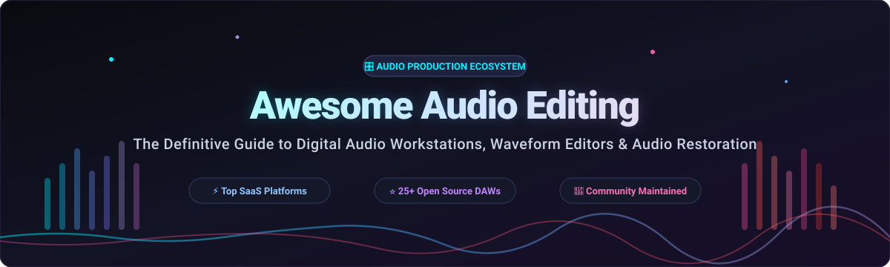

# 🎛️ Awesome Audio Editing

  
  
  
  
  
  
  

**A curated index of top-tier Digital Audio Workstations (DAW), audio editing software, waveform restoration tools, and music production suites.**

*Empowering sound engineers, music producers, podcasters, game audio designers, and developers with modern audio processing workflows.*

---

## 📌 Table of Contents

- [📊 Sector Overview & Market Dynamics](#-sector-overview--market-dynamics)
- [☁️ SaaS / Commercial Hosted Platforms](#️-saas--commercial-hosted-platforms)
- [💻 Open-Source GitHub Projects](#-open-source-github-projects)
- [🛠️ Audio Production Stack Architecture](#️-audio-production-stack-architecture)
- [🤝 How to Contribute](#-how-to-contribute)
- [💖 Support](#-support)
- [📈 Star History](#-star-history)
- [⚖️ Disclaimer](#️-disclaimer)

---

## 📊 Sector Overview & Market Dynamics

The global Digital Audio Workstation (DAW) and audio editing market is valued at approximately **$4.0 billion to $5.5 billion** (projected to reach over $8B to $11B by the mid-2030s at an ~8.5–9.2% CAGR). The sector exhibits **moderate concentration with a bifurcated landscape**: a handful of dominant legacy software/hardware conglomerates (Apple, Avid, Yamaha/Steinberg, Adobe) anchor the high-end studio and post-production industry with strong brand loyalty and ecosystem lock-in, while the broader creator, podcasting, and independent music tiers remain moderately fragmented and fiercely contested by nimble specialist DAWs and browser-based/freemium solutions.

---

## ☁️ SaaS / Commercial Hosted Platforms

A comprehensive overview of leading proprietary Digital Audio Workstations and spectral editing suites, sorted by enterprise valuation / organizational scale:

| Platform | Company Valuation / Revenue Scale | Pricing (Starting Tier) | Free Tier / Trial Limits | Key Highlights & Description |
| :--- | :--- | :--- | :--- | :--- |
| **[Logic Pro](https://www.apple.com/logic-pro/)** | Apple Inc. (~$3.5T Market Cap / ~$390B+ Annual Rev) | $199.99 one-time perpetual (or ~$12.99/mo via Apple Creator Studio bundle) | 30-day free trial (fully functional via Apple Creator Studio trial) | Apple's flagship Mac-only DAW featuring Virtual Drummer, Alchemy synthesizer, Spatial Audio mixing, and extensive stock sound libraries. |
| **[Adobe Audition](https://www.adobe.com/products/audition.html)** | Adobe Inc. (~$200B+ Market Cap / ~$21.4B Annual Rev) | $22.99/month (annual plan billed monthly; or $34.49/mo month-to-month) | 7-day free trial (fully functional across all features and audio restoration tools) | Industry standard for audio post-production, podcast mastering, multitrack waveform editing, spectral repair, and seamless Premiere Pro CC integration. |
| **[Steinberg Cubase](https://www.steinberg.net/cubase/)** | Yamaha Corp. (~$4B+ Market Cap / Steinberg ~$35M–$50M Rev) | $99.99 one-time perpetual (Cubase Elements 13) | 60-day free trial (fully functional Pro/Elements trial with zero feature restrictions) | Advanced MIDI sequencing standard with Chord Track, Harmonic Editing, and VariAudio pitch correction; popular among composers and arrangers. |
| **[Avid Pro Tools](https://www.avid.com/pro-tools)** | Avid Technology (~$1.4B Acquisition by STG / ~$400M+ Annual Rev) | $99/year or $9.99/month (Pro Tools Artist) | 30-day free trial (fully functional Pro Tools Ultimate/Studio trial requiring an iLok account) | The commercial studio recording and film post-production standard featuring Dolby Atmos integration, 130+ stock plugins, and track compiling. |
| **[PreSonus Studio One](https://www.presonus.com/products/Studio-One)** | Fender Musical Instruments Corp (~$1B Annual Rev / PreSonus ~$50M Rev) | $19.99/month (Studio One+ subscription) or $199.99 perpetual | 30-day free trial (fully functional Studio One Pro demo) | Streamlined DAW known for drag-and-drop workflow, integrated Melodyne pitch editing, project mastering suite, and live performance view. |
| **[Sound Forge Pro](https://www.magix.com/sound-forge/)** | MAGIX Software / Boris FX (~$30M–$50M Annual Rev) | $24.95/month (or $59.99 one-time for Audio Studio entry tier; $299.95 Pro perpetual) | 15-day free trial (fully functional trial available via Boris FX Hub) | Dedicated stereo and multichannel waveform audio editor focused on audio restoration, mastering, surgical cutting, and 64-bit VST3 processing. |
| **[Ableton Live](https://www.ableton.com/live/)** | Ableton AG (~$270M+ Valuation / ~$75M–$100M Annual Rev) | $99 one-time perpetual (Ableton Live Intro) | 30-day free trial (fully functional trial with unrestricted saving, exporting, and Max for Live) | Dual Session and Arrangement views for live performance and electronic production; known for audio warping and Max for Live device ecosystem. |
| **[FL Studio](https://www.image-line.com/fl-studio/)** | Image-Line (~$50M+ Valuation / ~$30M–$40M Annual Rev) | $99 one-time perpetual (Fruity Edition) | Time-unlimited evaluation (unrestricted features and audio export, but project reopening is locked until licensed) | Pattern-based DAW famous for its step sequencer, piano roll, bundled virtual instruments, and lifetime free updates policy. |
| **[Reaper](https://www.reaper.fm/)** | Cockos Inc. (Private boutique / Estimated $5M–$10M Annual Rev) | $60 one-time discounted personal license ($225 commercial) | 60-day free evaluation (fully functional with all features enabled; displays a brief startup reminder thereafter) | Ultra-lightweight, DRM-free DAW offering extreme customization, portable installation, JSFX scripting, and exceptional stability. |
| **[Acoustica](https://acondigital.com/products/acoustica/)** | Acon Digital (Private micro-entity / Estimated <$5M Annual Rev) | $59.90 one-time perpetual (Standard Edition; $199.90 Premium) | 30-day free trial (fully functional trial for Standard and Premium editions) | High-precision audio editor and post-production suite offering spectral editing, retouching algorithms, surround sound, and mastering tools. |

---

## 💻 Open-Source GitHub Projects

Curated open-source Digital Audio Workstations, waveform editors, and audio DSP engines, **sorted strictly by GitHub Star Count (descending)**:

- **[LosslessCut](https://github.com/mifi/lossless-cut)**   
  **The ultimate swiss army knife for lossless audio and video editing** (GPL-2.0). Perform near-instantaneous trimming, cutting, and splitting of audio/video streams without re-encoding or generational quality loss. Features timeline waveform inspection, chapter editing, track extraction, and high-performance ffmpeg bindings.

- **[Audacity](https://github.com/audacity/audacity)**   
  **The world's most widely recognized open-source audio editor and recording tool** (GPL-2.0/GPL-3.0). Free, cross-platform audio multi-tool with non-destructive effects, spectral editing, master bus compression, sample-accurate editing, and support for LV2, VST3, and AU plugins. Features OpenVINO AI toolkits for offline deep-learning noise suppression, stem separation, and automatic speech transcription.

- **[LMMS](https://github.com/LMMS/lmms)**   
  **Full-featured open-source cross-platform music production workstation** (GPL-2.0). Designed as a community alternative to FL Studio, featuring pattern-based drum sequencers, piano rolls, native synthesizers (Triple-Oscillator, Monstro, BitInvader), SF2/SF3 soundfont players, and comprehensive VST hosting for electronic beatmakers.

- **[wavesurfer.js](https://github.com/katspaugh/wavesurfer.js)**   
  **Interactive, highly customizable audio waveform visualizer and web editor library** (BSD-3-Clause). Built on Web Audio and HTML5 Canvas, providing developers with timeline markers, audio region selection, zooming, spectral analysis, and responsive audio playback navigation for modern web applications.

- **[Mixxx](https://github.com/mixxxdj/mixxx)**   
  **Professional open-source DJ mixing software and real-time audio manipulation engine** (GPL-2.0). Features ultra-low latency audio processing, dual-deck and four-deck timecode control, automated beat and key detection, stem separation, MIDI/HID hardware controller mapping, and broadcast streaming capabilities.

- **[Auto-Editor](https://github.com/WyattBlue/auto-editor)**   
  **High-velocity automated audio and video trimming utility** (Unlicense). Analyzes audio volume, silence thresholds, and motion metrics to automatically cut dead pauses, breaths, and silent sections out of raw recordings. Exports directly into Premiere, Final Cut Pro, DaVinci Resolve, or losslessly trimmed audio files.

- **[Ardour](https://github.com/Ardour/ardour)**   
  **The benchmark professional open-source Digital Audio Workstation** (GPL-2.0). Engineered for audio engineers, multi-track recording studios, sound designers, and Linux audio professionals. Features sample-accurate automation, unlimited audio and MIDI tracks, Region FX clip launcher, full routing matrix, Lua scripting engine, and industry-grade VST3/LV2 plugin hosts.

- **[Bespoke Synth](https://github.com/BespokeSynth/BespokeSynth)**   
  **Modular, patchable software synthesizer and interactive sound design DAW** (GPL-3.0). Allows you to build your own custom instrument and signal-processing ecosystem from scratch with hundreds of interconnected modules, Python live-coding support, and expressive algorithmic MIDI manipulation.

- **[Surge XT](https://github.com/surge-synthesizer/surge)**   
  **Legendary open-source hybrid synthesizer and audio DSP engine** (GPL-3.0). Features multiple synthesis engines (subtractive, wavetable, FM, physical modeling), flexible modulation matrices, expansive filter networks, microtonal tuning, and VST3/CLAP/AU support used by sound editors and electronic producers worldwide.

- **[Helio Workstation](https://github.com/helio-fm/helio-workstation)**   
  **Libre, minimalist music sequencer and MIDI composition DAW** (GPL-3.0). Cross-platform workstation for desktop and mobile focused on clean, distraction-free score writing, linear timeline composition, version control integration, and lightweight audio rendering.

- **[AudioMass](https://github.com/pkalogiros/AudioMass)**   
  **Browser-based open-source wave editor with zero installation** (MIT). Runs entirely on client-side Web Audio with waveform cutting, trimming, compression, parametric EQ, reverberation, delay, pitch shifting, spectrogram view, and fast MP3/WAV export.

- **[Signal](https://github.com/ryohey/signal)**   
  **Browser-based open-source online MIDI sequencing and score editing platform** (MIT). Features a clean TypeScript/React architecture, soundfont synthesis, velocity automation, multi-track piano roll, and instant MIDI export.

- **[Carla](https://github.com/falkTX/Carla)**   
  **Fully featured modular audio plugin host and rack environment** (GPL-2.0). Connects and bridges audio plugins across formats (LADSPA, DSSI, LV2, VST2, VST3, AU, CLAP) with flexible patchbay routing, MIDI mapping, and standalone execution.

- **[MilkyTracker](https://github.com/milkytracker/MilkyTracker)**   
  **Open-source, cross-platform Fasttracker II compatible tracker application** (BSD-3-Clause/GPL-3.0). Ideal for chiptune composers, game sound designers, and sample-based module arrangement in classic MOD and XM formats.

- **[Giada](https://github.com/monocasual/giada)**   
  **Minimalist, hardcore loop machine, live sampler, and electronic DAW** (GPL-3.0). Lightweight, low-latency audio engine for electronic live performance, clip launching, MIDI sequencing, and seamless VST/VST3 plugin hosting.

- **[audapolis](https://github.com/audapolis/audapolis)**   
  **Spoken-word media editor with integrated automatic speech-to-text transcription** (AGPL-3.0). Edit podcasts, interviews, and lectures just like a text document—cutting the transcribed words cuts the underlying audio waveforms automatically.

- **[waveform-playlist](https://github.com/naomiaro/waveform-playlist)**   
  **Multitrack Web Audio editing and canvas waveform preview canvas** (MIT). Web-based multitrack editor providing cues, fades, shift tracks in time, audio recording, annotations, and Tone.js effect chains.

- **[TuxGuitar](https://github.com/helge17/tuxguitar)**   
  **Multitrack tablature and sheet music editor** (LGPL-2.1). Features multitrack display, score viewer, tempo automation, guitar tuner, and MIDI playback for string instrument composition.

- **[Meadowlark DAW](https://github.com/MeadowlarkDAW/Meadowlark)**   
  **Modern open-source cross-platform Digital Audio Workstation written in Rust** (GPL-3.0). Built with a focus on high concurrency, memory safety, clean modular audio graphs, and native DSP performance.

- **[SoX (Sound eXchange)](https://github.com/chirlu/sox)**   
  **The venerable command-line Swiss Army knife of audio processing** (GPL-2.0/LGPL-2.1). Fast CLI utility to convert various sound file formats, apply high-quality audio filters, resample, normalize, and perform batch audio analysis scripts.

- **[Tenacity](https://github.com/tenacityteam/tenacity)**   
  **Privacy-first community fork of Audacity** (GPL-2.0). Provides a clean, telemetery-free audio editor with robust recording, multi-track mixing, noise reduction, and cross-platform desktop support.

- **[Qtractor](https://github.com/rncbc/qtractor)**   
  **Dedicated Audio/MIDI multi-track sequencer tailored for the Linux audio workstation** (GPL-2.0). Built around Qt and JACK/ALSA, featuring non-destructive editing, mixer buses, and comprehensive LADSPA, DSSI, LV2, and VST plugin formats.

- **[ysfx](https://github.com/jpcima/ysfx)**   
  **Open-source hosting library and plugin runtime for JSFX audio scripts** (Apache-2.0). Brings Cockos REAPER's renowned real-time procedural scripting language and DSP effects into any C++ host or digital audio environment.

- **[mhWaveEdit](https://github.com/magnush/mhwaveedit)**   
  **Lightweight, lightning-fast GTK+ sound file editor** (GPL-2.0). Exceptional performance for single-file clipping, leveling, and fast audio trimming on low-spec systems.

- **[OpenDaw](https://github.com/glenwrhodes/OpenDaw)**   
  **Next-generation open-source DAW featuring Claude AI integration** (GPL-3.0). Powered by Qt 6 and the Tracktion audio engine, providing VST3 instrument hosting, signal node graphs, and real-time AI composition assistance.

- **[Kwave](https://github.com/KDE/kwave)**   
  **Sound editor built specifically for the KDE desktop ecosystem** (GPL-2.0). Features 24-bit multi-channel audio recording, sonogram viewing, bandpass filters, and non-destructive audio editing.

---

## 🛠️ Audio Production Stack Architecture

When designing a production pipeline using open-source audio tooling, combine the following tiers for complete coverage:

1. **Multitrack Studio Production**: [Ardour](https://github.com/Ardour/ardour) (full tracking, mixing, mastering) or [LMMS](https://github.com/LMMS/lmms) (beatmaking & MIDI synthesis).
2. **Surgical Waveform & Noise Repair**: [Audacity](https://github.com/audacity/audacity) (local OpenVINO AI stem separation & noise reduction) or [ocenaudio](https://www.ocenaudio.com/).
3. **Automated Batch Processing & Trimming**: [LosslessCut](https://github.com/mifi/lossless-cut) (zero-loss trimming), [Auto-Editor](https://github.com/WyattBlue/auto-editor) (silence removal), and [SoX](https://github.com/chirlu/sox) (CLI scripting & normalization).
4. **Podcast & Speech-to-Text Post-Production**: [audapolis](https://github.com/audapolis/audapolis) (text-driven timeline edits).

---

## 🤝 How to Contribute

Contributions are warmly encouraged! To propose a new software package or update existing entries:

1. 🍴 **Fork the repository**.
2. 🌿 **Create a descriptive feature branch** (`git checkout -b feature/add-new-audio-tool`).
3. 📝 **Add or edit entries in `README.md`** following the established format:
   - For SaaS: include specific starting pricing tiers, explicit free tier / trial terms, and parent company scale.
   - For Open-Source: include name, official repository link, GitHub star badge, license, and technical summary.
4. 🚀 **Submit a Pull Request** with a concise description of your additions.

---

## 💖 Support

If you found **Awesome-Audio-Editing** helpful for your sound engineering, music production, or development workflow, please consider showing your support:

- ⭐ **Star this repository** on GitHub to help others discover it!
- 🍴 **Fork it** and share it with fellow audio creators and engineers.
- ☕ **Sponsor or Buy Me a Coffee**: [**Sponsor Dashboard on GitHub**](https://github.com/sponsors/ishandutta2007)

Every contribution helps keep this directory actively maintained, accurate, and up-to-date!

---

## 📈 Star History

---

## ⚖️ Disclaimer

- This repository is a **community-curated index** created for educational, research, and technical workflow evaluation purposes. Mentions do not constitute commercial endorsements.
- Audio editing and music production require strict adherence to licensing and copyright laws for samples, loops, and recorded media. Always review commercial plugin and library licenses before using them in monetized productions.
- Digital signal processing (DSP) involves irreversible operations; always keep uncompressed raw backups of source stems and multi-track sessions.
